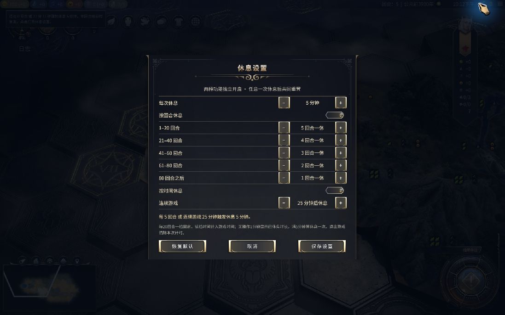

# 休息一下 · Rest Guard

为《文明 VII》单人游戏加入按回合与按时间两种强制休息功能。两个开关独立设置，任意一次休息完成后共同重置。

**当前版本：1.3.0 · 中文界面 · 已验证 Windows / Steam 游戏版本 1.5.0**

[Steam 创意工坊](https://steamcommunity.com/sharedfiles/filedetails/?id=3815557333) · [下载发布版](https://github.com/Stupidism/civ7-rest-guard/releases) · [完整使用说明](README-zh-CN.txt) · [验证记录](VALIDATION.txt)



## 默认规则

### 按回合休息

直接读取游戏自身的回合数。第 0 回合是起点，首次在**第 5 回合结束时**休息，不会提前到第 4 回合。

| 当前回合 | 默认休息间隔 |
| --- | --- |
| 1–20 | 每 5 回合 |
| 21–40 | 每 4 回合 |
| 41–60 | 每 3 回合 |
| 61–80 | 每 2 回合 |
| 81 及以后 | 每回合 |

每 20 回合一档是固定规则；各档间隔可以调整为 1–100 回合。不会自行追溯或累计跨时代的回合历史。

### 按时间休息

- 连续游戏 **25 分钟**后强制休息 **5 分钟**，无需等到结束回合。
- 游戏内读档、返回主菜单后重新加载的等待时间计入本次连续游戏时间。
- 连续无操作 1 分钟后显示“已休息 X 分 Y 秒”；满 5 分钟视为完成一次休息。
- 完成空闲休息后，恢复操作才重新开始计时；离开更久不会重复弹出休息锁。
- 完整退出游戏后，本次计时清零。关闭时间功能也会关闭空闲自动重置。

连续游戏上限可设为 1–240 分钟，休息时长可设为 0.1–120 分钟。

### 共同重置

两项默认同时开启，先到期的一项触发休息，同时到期只休息一次。完成强制休息或空闲休息后，游戏时间和下一次回合休息间隔一起重置。

例如本来第 5 回合要休息，第 4 回合先完成了时间休息，那么下一次回合休息会移到第 9 回合。固定的 20 回合分档边界不变。

## 界面

右上角入口接入原版系统栏的最右端，用游戏自带的回合、时间图标与数字显示剩余量；悬浮查看完整文字，点击打开设置。原版菜单、百科和时钟仍保留在同一栏。


休息期间显示全屏倒计时，阻止游戏操作和过回合。倒计时结束后点击“休息完成，继续”。按回合触发时继续原来的过回合操作；按时间触发时恢复当前回合。


更多实机截图：[悬浮说明](docs/screenshots/02-tooltip.jpg) · [空闲提示](docs/screenshots/04-idle.jpg) · [休息完成](docs/screenshots/12-rest-complete.jpg)。部分验证截图使用临时缩短的时长，发布版默认仍为 25 分钟游戏 / 5 分钟休息。

## 安装

### Steam 创意工坊

1. [订阅 Mod](https://steamcommunity.com/sharedfiles/filedetails/?id=3815557333)，等待 Steam 下载并重启游戏。
2. 在游戏“附加内容”中启用“休息一下 · Rest Guard”。
3. 载入单人存档，点击右上角入口调整设置。

如果之前手动安装过同名 Mod，请先将本地 `Mods/civ7-rest-guard` 文件夹移出 Mods 目录，避免加载两份。

### Windows 手动安装

下载并解压发布版，退出游戏后双击 `install.cmd`。也可以克隆本仓库后双击该文件。

安装位置：

```text
%LOCALAPPDATA%/Firaxis Games/Sid Meier's Civilization VII/Mods/civ7-rest-guard
```

安装器会备份已有版本，并核对复制后的文件。游戏内已有设置会保留。手动卸载时退出游戏，再移出该 Mod 文件夹即可。

## 兼容性与数据

- 仅用于单人游戏；多人及热座不启用。
- 可以用于已有单人存档，不修改原版游戏文件或存档数据。
- 设置及休息面板使用原版 `fxs-*` 控件，图标直接引用已安装游戏的资源。
- 长期只保存设置，不建立战役或回合历史。读档时使用一次性的临时交接状态，目标界面读取后清除。
- 这是游戏内休息控制，不是操作系统级的应用锁。
- 尚未验证其他平台或所有第三方界面 Mod 的组合。

## 开发与测试

无需安装 npm 依赖。使用支持内置测试运行器的现代 Node.js，在仓库根目录执行：

```sh
npm test
```

现有 48 项测试覆盖回合边界、时间与空闲触发、共同重置、读档交接、输入拦截和存储兼容性。自动化检查不能替代游戏中的 UI 验证；实机验证范围见 [VALIDATION.txt](VALIDATION.txt)。

| 文件 | 职责 |
| --- | --- |
| `rest-guard.modinfo` | 游戏加载清单 |
| `ui/defaults.js` | 初始设置 |
| `ui/rest-model.js` | 固定回合分档与休息锁 |
| `ui/rest-session.js` | 双功能触发、空闲与共同重置 |
| `ui/rest-runtime.js` / `ui/rest-shell.js` | 游戏与主菜单间读档交接 |
| `ui/rest-store.js` | 设置保存与迁移 |
| `ui/rest-guard.js` | 游戏输入和过回合接入 |
| `ui/rest-view.js` / `ui/rest-guard.css` | 原生风格界面 |
| `tests/` | Node.js 回归测试 |

## English summary

A single-player Civilization VII mod with independent turn-based and time-based break triggers. Defaults are one break every 5/4/3/2/1 turns across fixed 20-turn stages, or after 25 minutes of continuous play, followed by a 5-minute rest. The first turn-based break occurs at the end of turn 5. Five minutes of inactivity also counts as a break. Completing any break resets both counters. In-game loading time is included; exiting the game clears the session timer.

The compact top-right indicator and settings use native game controls. The current interface is Chinese. Tested on Civilization VII 1.5.0 for Windows / Steam. This repository contains the mod source and tests; it does not redistribute the game's UI assets or SDK.
